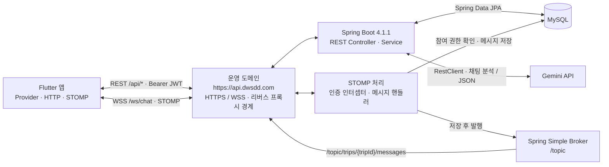
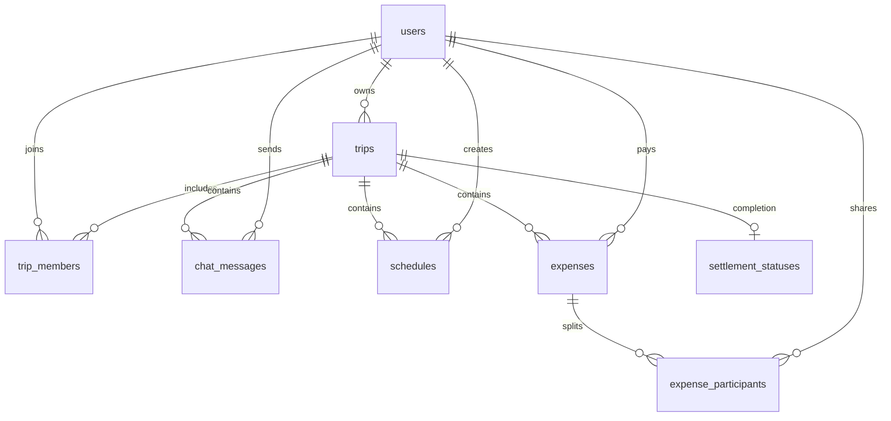

# TripMate

**대화를 일정과 정산으로 연결하는 AI 기반 협업 여행 관리 앱**

Flutter와 Spring Boot로 여행방 중심의 채팅·공유 일정·지출 관리를 구현했습니다. 실시간 채팅에서 논의한 내용을 Gemini로 구조화하고, 사용자가 검토한 항목을 일정과 지출로 저장합니다.

> 작성 기준: 2026-11-21 현재 작업 디렉터리의 소스와 설정. 구현 설명은 코드 기준이며 최신 코드의 운영 배포, 실제 DB 스키마, 외부 API 연동 성공을 보장하지 않습니다.

## 프로젝트 소개 및 기획 배경

여행을 준비하는 대화에는 방문 장소, 예약 날짜, 결제 금액이 함께 섞여 있습니다. 대화가 길어지면 합의한 계획을 다시 찾고 캘린더와 정산 장부에 옮기는 작업이 반복됩니다.

TripMate는 **여행방을 협업의 기준 단위**로 삼아 이 작업을 연결합니다. 같은 여행에 참여한 사용자가 대화하고 일정을 공유하며, 결제자와 실제 분담 대상을 구분해 비용을 정산합니다. AI는 등록 후보를 제안하고, 최종 저장은 사용자가 선택·확인하도록 설계했습니다.

## 주요 기능

| 기능 | 실제 구현 범위 |
| --- | --- |
| 회원가입·로그인 | 이메일 회원가입, BCrypt 비밀번호 해싱, JWT 발급·검증. Provider와 SharedPreferences로 앱 로그인 상태 보관 |
| 여행방 생성·초대 | 여행 생성·참여 여행 목록 조회, 가입된 사용자의 이메일로 멤버 추가, 참여자 조회. 앱 생성 화면은 제목 입력 제공 |
| 실시간 채팅 | REST 메시지 이력 조회, WebSocket/STOMP 텍스트 송수신, 여행별 topic 구독, 메시지 DB 저장 |
| Gemini 채팅 분석 | 채팅 로그에서 `SCHEDULE`·`RESERVATION`·`SETTLEMENT` 추출, 사용자 선택·지출 확인 후 저장, 기존 항목 비교와 실패 항목 재시도 |
| 통합 캘린더 | 참여 여행의 공유 일정을 모아 월간·선택일 목록 표시, 여행별 타임라인, 일정 추가·삭제, 상세 정보·URL 복사 |
| 균등 정산 | 지출 등록·수정·삭제, 결제자·분담 대상 선택, 1원 단위 분배, 결제자별·장소별 집계, 개인별 보낼/받을 금액과 송금 계획 |
| 정산 완료 관리 | 사용자 요청으로 여행별 완료 표시·해제. 지출 변경 시 완료 상태 해제 |
| 홈 대시보드 | 실제 여행·일정·정산 API를 조합해 예정 여행, 가까운 일정, 미완료 정산 표시 |

일정·예약 저장은 서버의 중복 확인 API를 사용합니다. 지출 중복은 앱에서 기존 지출과 비교하며, 서버의 동시 중복 방지와는 범위가 다릅니다. 예약은 시작일의 일정으로 저장하고 종료일은 메모에 남깁니다. 송금 계획은 계산 결과이며 실제 금융 송금을 실행하지 않습니다.

## 시스템 아키텍처



일반 REST와 AI 분석은 [AuthService.baseUrl](frontend/lib/services/auth_service.dart)의 `https://api.dwsdd.com`을 공유합니다. STOMP 주소는 이 상수에서 `wss://api.dwsdd.com/ws/chat`로 변환합니다. 서버는 `/app`을 애플리케이션 메시지 접두사로 사용하고 `/topic`에 내장 Simple Broker를 설정합니다.

**인프라 확인 범위:** 개인 온프레미스 서버·Docker 기반 운영 환경은 [기존 운영 기록](docs/architecture/README.md)에 언급되어 있습니다. 앱에는 HTTPS 도메인과 WSS 연결이 설정되어 있으나 저장소에 Dockerfile, Compose, 리버스 프록시·SSL 인증서 설정은 없습니다. 위 다이어그램의 프록시 경계는 운영 연결 구조를 설명하며, 현재 서버의 컨테이너 구성·TLS 종료 지점·인증서 상태를 소스로 검증한 배포 명세는 아닙니다.

## 기술 스택

| 영역 | 기술 | 적용 내용 |
| --- | --- | --- |
| Backend | Java 21, Spring Boot 4.1.1, Gradle Wrapper | 도메인별 Controller·Service·Repository 구성 |
| Persistence | Spring Data JPA, Hibernate, MySQL Connector/J | 엔티티 매핑, 트랜잭션, 여행 행 비관적 잠금 |
| Realtime | Spring WebSocket, STOMP, Simple Broker | 연결 인증, 여행별 구독 검증, 텍스트 메시지 발행 |
| Authentication | JJWT 0.12.6, BCrypt | 서명·만료 검증, 사용자 ID 해석, 비밀번호 해싱 |
| AI integration | Spring RestClient, Jackson, Gemini API | 외부 API 호출과 JSON 파싱 |
| Validation / Error | Jakarta Validation, `@RestControllerAdvice` | DTO 검증, REST 예외 상태·응답 형식 통일 |
| Database | MySQL | 사용자·여행·채팅·일정·지출·정산 완료 상태 저장 |
| Frontend | Flutter, Dart SDK `^3.13.3`, Provider | 화면·컨트롤러 분리, ChangeNotifier 기반 상태 갱신 |
| Client libraries | `http`, `stomp_dart_client`, `shared_preferences`, `table_calendar` | REST·STOMP 통신, 로그인 상태 보관, 캘린더 |
| Test | JUnit Jupiter, Mockito, MockMvc, Flutter Test | 순수 도메인·서비스 단위 테스트, HTTP 오류·인증 및 앱 컨트롤러·위젯 검증 |
| Infra | 개인 온프레미스 서버, Docker 운영 기록, 도메인·HTTPS/WSS 설정 | 운영 기록과 앱 설정 기준. 배포·프록시·SSL 구성 파일은 저장소에 미포함 |

구체적인 의존성은 [backend/build.gradle](backend/build.gradle), [frontend/pubspec.yaml](frontend/pubspec.yaml)을 기준으로 합니다. Spring Security는 비밀번호 암호화 모듈을 사용하며 REST 인증은 공통 Security Filter Chain 대신 Controller의 `AuthUserIdResolver` 호출로 처리합니다.

## 데이터베이스 구조

아래 ERD는 JPA 매핑과 서비스가 사용하는 ID 관계를 함께 표현한 **논리 관계도**입니다. 모든 선이 운영 DB의 물리적 외래 키를 의미하지는 않습니다.



| 테이블 | 핵심 컬럼·제약 | 설계 목적 |
| --- | --- | --- |
| `users` | `id` PK, `email` UNIQUE, `password`, `nickname`, `created_at`, `updated_at` | 사용자와 BCrypt 비밀번호 보관 |
| `trips` | `id` PK, `owner_id`, `title`, `destination`, `start_date`, `end_date` | 협업 단위와 소유자 관리. 여행지·날짜는 선택값 |
| `trip_members` | `id` PK, `trip_id`, `user_id`, `role`, `joined_at`; `(trip_id, user_id)` UNIQUE | 여행·사용자의 다대다 참여 관계와 중복 참여 제약 |
| `chat_messages` | `id` PK, `trip_id`, `sender_id`, `message`, `message_type`, `created_at` | 여행별 텍스트 메시지 이력과 AI 분석 원문 |
| `schedules` | `id` PK, `trip_id`, `title`, `category`, `schedule_date`, `start_time`, `place_name`, `url`, `memo`, `sort_order`, `created_by` | 확정 공유 일정과 표시 순서·생성자 관리 |
| `expenses` | `id` PK, `trip_id`, `title`, `amount`, `payer_id`, `place_name`, `expense_date` | 실제 결제 금액과 결제자 보관. 금액은 `Long` 정수 |
| `expense_participants` | `expense_id`, `user_id`; 두 컬럼 조합 UNIQUE | `@ElementCollection Set<Long>`으로 실제 분담 사용자 ID 집합 보관 |
| `settlement_statuses` | `trip_id` PK, `completed_at` | 여행별 완료 기록. 완료 해제 시 시각을 null로 변경 |

핵심 설계 포인트는 다음과 같습니다.

- **소유자와 참여자 분리:** 소유자는 `trips.owner_id`로 관리합니다. 조회·권한 검사에서 소유자와 `trip_members`를 함께 고려하며 소유자가 멤버 테이블에 존재한다고 가정하지 않습니다. 여행방은 `trips`를 사용하며 별도 `chat_rooms` 엔티티는 없습니다.
- **결제자와 분담자 분리:** 결제자가 분담 대상에 포함되지 않는 지출도 표현할 수 있습니다. 서비스에서 결제자·분담 대상의 여행 참여 여부와 분담 ID 중복을 검증합니다.
- **API 필드와 저장 컬럼 구분:** 일정 `scheduledDate` → `schedule_date`, `scheduledTime` → `start_time`, `description` → `memo`; 채팅 `content` → `message`, `sentAt` → `created_at`으로 매핑합니다.
- **관계 매핑의 범위:** `expenses.payerId`, 분담 사용자 ID, `settlement_statuses.tripId`는 숫자 ID로 저장합니다. [정산 SQL](database/settlement.sql)의 외래 키 정의와 JPA 자동 생성 제약이 동일하다고 단정하지 않습니다.

`ScheduleCandidate` / `schedule_candidates`는 엔티티만 존재합니다. 현재 AI 결과를 이 테이블에 적재하거나 승인·거부하는 API는 연결되어 있지 않습니다. 상세 내용은 [DB 구조](docs/database/README.md)를 참고하세요.

## 핵심 백엔드 구현 및 트러블슈팅

### 1. STOMP 연결·구독·전송 단계의 인증과 여행 권한 검사

WebSocket 연결 성공만으로 다른 여행의 메시지에 접근하지 않도록 인증과 여행 권한 검사를 단계별로 적용했습니다.

1. 앱이 STOMP `CONNECT` native header에 `Authorization: Bearer <token>`을 전달합니다.
2. `StompAuthChannelInterceptor`가 `AuthUserIdResolver`로 JWT를 검증하고 사용자 ID를 `StompPrincipal`에 연결합니다.
3. `/topic/trips/{tripId}/...` 구독 시 destination에서 여행 ID를 추출하고 `verifyChatRoomAccess`로 소유자·참여자 여부를 확인합니다.
4. `/app/trips/{tripId}/messages` 전송 시 Controller가 Principal을 확인하고, `ChatRoomService`가 대상 여행 접근 권한·메시지 내용을 검증해 DB에 저장합니다.
5. 저장된 메시지의 응답 DTO를 해당 여행 topic에 발행합니다. 앱의 메시지 이력 조회는 별도 REST API를 사용합니다.

메시지 전송은 2,000자 이내의 비어 있지 않은 텍스트를 처리합니다. 앱은 재연결 지연을 5초로 설정합니다. 현재 브로커는 애플리케이션 내장 Simple Broker입니다.

근거: [STOMP 인터셉터](backend/src/main/java/com/tripmate/backend/chat/StompAuthChannelInterceptor.java), [메시지 핸들러](backend/src/main/java/com/tripmate/backend/chat/ChatStompController.java), [채팅 서비스](backend/src/main/java/com/tripmate/backend/chat/ChatRoomService.java).

### 2. 비정형 채팅의 구조화와 사용자 검수·중복 방지 저장

분석 결과를 곧바로 DB에 확정하는 대신 **추출 → 검수 → 중복 확인 → 저장** 흐름으로 나눴습니다.

- `AiChatAnalysisService`가 여행 접근 권한을 확인한 뒤 채팅을 전송 시각순으로 조회하고, 시각·닉네임·본문을 분석 프롬프트에 구성합니다.
- `GeminiService`가 RestClient로 Gemini를 호출합니다. 코드의 모델 경로는 `gemini-3.5-flash-lite:generateContent`입니다.
- 프롬프트는 세 가지 항목 유형과 날짜·시간·금액·인원·URL 필드를 지정하고, 알 수 없는 값은 null로 반환하도록 지시합니다. 결과는 Jackson으로 `AiAnalyzeResponse`에 역직렬화합니다. 이는 프롬프트와 파싱 기반이며 모델 응답의 정확성이나 스키마 준수를 보장하는 검증 계층은 아닙니다.
- 앱의 `AiSummaryController`는 날짜·제목·시간 형식을 확인하고 기존 일정과 동일 항목·중복 의심 항목을 구분합니다. 사용자는 저장할 일정을 선택하고, 지출은 금액·결제자·실제 분담 대상 등을 확인합니다. AI의 `peopleCount`만으로 분담 사용자를 확정하지 않습니다.

**응답 유실 후 재시도와 중복 저장 대응:** `POST /api/trips/{tripId}/schedules/import`는 `READ_COMMITTED` 트랜잭션에서 여행 행을 `PESSIMISTIC_WRITE`로 잠근 뒤 기존 일정을 비교합니다. 날짜·시간과 공백을 제거한 제목·장소가 같으면 새로 저장하지 않고 기존 일정을 반환합니다.

| 결과 | HTTP | 응답 |
| --- | --- | --- |
| 새 일정 저장 | 201 | `{created: true, schedule: ...}` |
| 동일 일정 존재 | 200 | `{created: false, schedule: ...}` |

일반 일정 생성도 같은 여행 행 잠금을 사용합니다. 동일 시각이어도 제목이 다르면 import가 허용되며, 동일성 비교에는 카테고리·URL·메모가 포함되지 않습니다. 수정 API까지 포괄하는 DB 유일 제약이나 범용 Idempotency-Key 방식은 아닙니다.

지출은 앱에서 제목·금액·결제자·날짜·장소·분담자 집합을 기존 지출과 비교합니다. 여러 일정·지출은 개별 요청으로 저장하므로 일부 성공할 수 있고, 앱은 저장된 항목을 제외하고 남은 항목을 재시도합니다. 지출의 동시 요청 중복 방지는 향후 과제입니다.

근거: [AI 분석 서비스](backend/src/main/java/com/tripmate/backend/ai/AiChatAnalysisService.java), [일정 import 서비스](backend/src/main/java/com/tripmate/backend/schedule/ScheduleService.java), [여행 행 잠금](backend/src/main/java/com/tripmate/backend/trip/TripRepository.java), [앱 검수·저장 컨트롤러](frontend/lib/controllers/chat/ai_summary_controller.dart).

### 3. 1원 단위 금액 보존과 순수 도메인 정산 알고리즘

`SettlementCalculator`를 Spring·JPA에 의존하지 않는 순수 Java 계산 클래스로 분리했습니다. 입력은 참여 사용자 ID와 지출별 금액·결제자·분담자이며, 출력은 총액·개인별 잔액·송금 계획입니다.

1. 분담 사용자 ID를 중복 제거하고 오름차순으로 정렬합니다.
2. 지출 금액을 분담 인원으로 나눈 몫을 기본 분담액으로 설정합니다.
3. 나머지 금액만큼 앞선 사용자부터 1원씩 추가 배분합니다.
4. 사용자별 `결제액 - 분담액`으로 받을 금액과 보낼 금액을 계산합니다.
5. 채무자와 채권자를 순서대로 매칭해 남은 금액 중 작은 값을 송금액으로 배정합니다.

예를 들어 사용자 ID 1·2·3이 100원을 분담하고 1번 사용자가 전액 결제했다면 다음 결과를 반환합니다.

| 사용자 | 결제액 | 분담액 | 잔액 |
| --- | ---: | ---: | ---: |
| 1 | 100원 | 34원 | +66원 |
| 2 | 0원 | 33원 | -33원 |
| 3 | 0원 | 33원 | -33원 |

송금 계획은 `2 → 1: 33원`, `3 → 1: 33원`입니다. 부동소수점 대신 `long`을 사용하고 누적 합산에 `Math.addExact`를 적용합니다. 이 순차 매칭을 전역 최소 송금 횟수 최적화 알고리즘으로 주장하지 않습니다.

**단위 테스트 설계:** 잔여 금액 배분, 결제자와 분담자의 차이, 지출 없음·잔액 상쇄, 외부 사용자·잘못된 금액 거부를 검증합니다. 고정 시드로 생성한 100개 지출 패턴에서는 분담액 합계가 총액과 같고 송금 계획 적용 후 모든 잔액이 0이 되는 불변식을 확인합니다. 서비스 테스트는 여행 접근 권한, 결제자·분담자 검증, 지출 수정 시 완료 해제와 빈 여행의 완료 거부를 별도로 확인합니다.

정산 서비스는 지출 변경과 완료 상태 변경 시 여행 행을 잠그고, 지출 변경과 완료 해제를 같은 트랜잭션에서 처리합니다.

근거: [SettlementCalculator](backend/src/main/java/com/tripmate/backend/settlement/SettlementCalculator.java), [계산 단위 테스트](backend/src/test/java/com/tripmate/backend/settlement/SettlementCalculatorTest.java), [서비스 테스트](backend/src/test/java/com/tripmate/backend/settlement/SettlementServiceTest.java).

### 4. AI API 보호·운영 주소 통합·REST 예외 처리 개선

| 개선 대상 | 적용한 변경 | 검증·효과 |
| --- | --- | --- |
| AI 분석·테스트의 인증 누락 | `AuthUserIdResolver`로 JWT 검증, `AiTripAccess`로 여행 소유자·참여자 확인. 테스트 API도 `tripId` 필수 | 토큰 누락·무효·만료와 비참여자 요청이 채팅 조회·Gemini 호출 전에 차단되는지 MockMvc로 검증 |
| AI만 별도 HTTP 주소 사용 | 앱 AI 요청을 `AuthService.baseUrl`에 연결하고 Bearer 헤더 전달 | REST·AI·STOMP가 하나의 도메인 상수에서 주소를 결정 |
| 업무·입력 오류의 500 응답 가능성 | `GlobalExceptionHandler` 하나로 `IllegalArgumentException`, `SecurityException`, MVC 요청 오류와 `ResponseStatusException` 처리 | 오류 상태와 JSON 형식 통일, 기존 401·404 유지 |
| 로그인 실패 후 버튼 비활성화 | `finally`에서 로딩 해제, `mounted` 확인 후 상태 갱신 | 실패 후 재시도 가능한 UI 상태로 복귀 |

REST 오류 형식:

```json
{
  "status": 400,
  "error": "Bad Request",
  "message": "이미 사용 중인 이메일입니다.",
  "path": "/api/auth/signup"
}
```

중복 이메일·로그인 정보 불일치·입력 검증 실패는 400, 누락·무효 JWT는 401, `SecurityException`은 403으로 처리합니다. 여행 접근 불가·리소스 없음은 기존 서비스 규칙대로 404입니다. 이 핸들러가 모든 예기치 않은 서버 예외나 STOMP 오류까지 같은 JSON으로 변환하는 것은 아닙니다.

근거: [AI 권한 검사](backend/src/main/java/com/tripmate/backend/ai/AiTripAccess.java), [AI 보안 회귀 테스트](backend/src/test/java/com/tripmate/backend/ai/AiAuthorizationTest.java), [전역 예외 핸들러](backend/src/main/java/com/tripmate/backend/common/GlobalExceptionHandler.java), [오류 응답 테스트](backend/src/test/java/com/tripmate/backend/common/GlobalExceptionHandlerTest.java).

## API 명세 요약

회원가입·로그인을 제외한 아래 REST API는 `Authorization: Bearer <accessToken>`을 사용합니다. 여행별 리소스는 소유자 또는 참여자 접근을 검사합니다.

| 영역 | Method | 경로 | 성공 응답·동작 |
| --- | --- | --- | --- |
| 인증 | POST | `/api/auth/signup` | 200, 회원가입 성공 문자열 |
| 인증 | POST | `/api/auth/login` | 200, 사용자 정보·`accessToken` |
| 여행 | GET / POST | `/api/trips` | 200 목록 / 201 생성 |
| 참여자 | GET / POST | `/api/trips/{tripId}/members` | 200 목록 / 201 이메일로 멤버 추가 |
| 채팅 | GET | `/api/chat/rooms` | 200, 여행방·최근 메시지 정보 |
| 채팅 | GET / POST | `/api/chat/rooms/{tripId}/messages` | 200 이력 / 201 REST 메시지 저장 |
| AI | POST | `/api/trips/{tripId}/ai/analyze` | 200, `{items: [...]}` |
| AI 테스트 | GET | `/api/ai/test?tripId=...&message=...` | 200, Gemini 응답 문자열 |
| 일정 | GET / POST | `/api/trips/{tripId}/schedules` | 200 목록 / 201 생성 |
| 일정 import | POST | `/api/trips/{tripId}/schedules/import` | 201 신규 / 200 기존 일정 |
| 일정 | PATCH / DELETE | `/api/schedules/{scheduleId}` | 200 수정 / 204 삭제 |
| 정산 | GET | `/api/settlements` | 200, 참여 여행별 정산 목록 |
| 정산 | GET | `/api/trips/{tripId}/settlement` | 200, 지출·개인별 잔액·송금 계획 |
| 지출 | POST | `/api/trips/{tripId}/expenses` | 201, 본문 없음 |
| 지출 | PATCH / DELETE | `/api/expenses/{expenseId}` | 204 |
| 정산 완료 | PATCH | `/api/trips/{tripId}/settlement` | 204, `{completed: true 또는 false}` 요청 |

앱의 새 채팅 메시지는 STOMP를 사용합니다. REST 메시지 저장 경로는 STOMP topic 발행을 수행하지 않습니다. 일정 PATCH API와 서비스는 구현되어 있으며 앱 편집 UI 연결은 향후 과제입니다.

| WebSocket / STOMP | 경로·헤더 | 역할 |
| --- | --- | --- |
| WebSocket 연결 | `wss://api.dwsdd.com/ws/chat` | 서버 등록 경로 `/ws/chat`, SockJS 미사용 |
| CONNECT 인증 | `Authorization: Bearer <accessToken>` | STOMP native header로 JWT 전달 |
| SEND | `/app/trips/{tripId}/messages` | `{ "content": "메시지" }` 전송 |
| SUBSCRIBE | `/topic/trips/{tripId}/messages` | 여행 권한 확인 후 메시지 수신 |

상세 DTO·요청 예시는 [API 명세](docs/api/api-spec.md)를 참고하세요.

## 프로젝트 디렉터리 구조 및 실행 방법

```text
TripMate/
├── backend/
│   ├── build.gradle
│   └── src/
│       ├── main/
│       │   ├── java/com/tripmate/backend/
│       │   │   ├── auth/        # JWT·회원가입·로그인
│       │   │   ├── user/        # 사용자 엔티티·저장소
│       │   │   ├── trip/        # 여행·참여자·접근 조회·행 잠금
│       │   │   ├── chat/        # REST·STOMP·연결 인증
│       │   │   ├── ai/          # Gemini 호출·채팅 분석·권한 확인
│       │   │   ├── schedule/    # 공유 일정·중복 확인 import
│       │   │   ├── settlement/  # 지출·정산 계산·완료 관리
│       │   │   └── common/      # 전역 REST 예외 처리
│       │   └── resources/application.properties
│       └── test/java/com/tripmate/backend/
├── frontend/
│   ├── lib/
│   │   ├── main.dart
│   │   ├── controllers/         # 홈·채팅·AI 저장·캘린더·정산 상태
│   │   ├── models/              # API 응답·화면 데이터 모델
│   │   ├── providers/           # 로그인 상태
│   │   ├── services/            # REST·STOMP 클라이언트
│   │   ├── screens/             # 인증·홈·채팅·캘린더·정산 화면
│   │   └── widgets/             # 기능별 UI·표시 데이터 변환
│   └── test/                   # 컨트롤러·위젯·fixture
├── database/                   # 스키마 안내·정산 추가 SQL
└── docs/                       # 요구사항·아키텍처·API·DB·UI 상세
```

### 백엔드

Java 21, MySQL 데이터베이스·접속 계정, Gemini API 키를 준비합니다. [application.properties](backend/src/main/resources/application.properties)는 환경변수 또는 실행 디렉터리의 `.env` 속성 파일을 읽습니다.

| 필수 환경변수 | 용도·예시 |
| --- | --- |
| `DB_URL` | JDBC URL, 예: `jdbc:mysql://localhost:3306/tripmate` |
| `DB_USERNAME` | MySQL 접속 사용자 |
| `DB_PASSWORD` | MySQL 접속 비밀번호 |
| `JWT_SECRET` | HMAC 서명 키. 최소 32바이트 이상의 충분히 긴 비밀값 |
| `GEMINI_API_KEY` | Gemini API 호출 키 |

`backend/.env` 예시입니다. 예시 값을 실제 환경 값으로 교체합니다.

```properties
DB_URL=jdbc:mysql://localhost:3306/tripmate
DB_USERNAME=tripmate
DB_PASSWORD=replace-with-your-db-password
JWT_SECRET=replace-with-a-random-secret-of-at-least-32-bytes
GEMINI_API_KEY=replace-with-your-gemini-api-key
```

`.env`는 Git 제외 대상입니다. 현재 JWT 유효기간은 `jwt.expiration=86400000`으로 24시간입니다. JPA 설정은 `ddl-auto=update`, `show-sql=true`이며 시작 시 연결된 DB의 스키마 갱신을 시도합니다. DB와 계정은 먼저 준비해야 하며 `database/schema.sql`·`seed.sql`은 실행 가능한 전체 스키마·시드가 아닙니다.

```powershell
# Windows PowerShell: 저장소 루트에서
cd backend
.\gradlew.bat bootRun
```

```bash
# Linux / macOS: 저장소 루트에서
cd backend
./gradlew bootRun
```

별도 서버 포트 설정은 없어 로컬 실행은 Spring Boot 기본 포트 8080을 사용합니다. Docker 실행 명령은 배포 파일이 저장소에 없어 제공하지 않습니다.

### 프론트엔드

Flutter와 Dart SDK `^3.13.3` 조건을 만족하는 환경에서 실행합니다.

```powershell
cd frontend
flutter pub get
flutter run -d chrome
```

기본 앱 연결 대상은 운영 도메인입니다. 로컬 백엔드를 사용할 때는 `frontend/lib/services/auth_service.dart`의 `AuthService.baseUrl`을 실행 기기에서 접근 가능한 주소로 변경합니다. AI와 STOMP도 이 값을 따라가며, 현재 `--dart-define` 기반 환경 전환 설정은 없습니다.

### 테스트와 검증 범위

현재 소스에 대응하는 최근 로컬 결과에서 DB 독립 백엔드 테스트 **22개**가 통과했습니다. 전역 예외 처리 5개, AI 인증 4개, 일정 import 4개, 정산 계산 5개, 정산 서비스 4개입니다. 로그인 화면을 포함한 최근 변경 Dart 파일의 정적 분석도 통과했습니다.

```powershell
# backend/에서: DB 없이 실행하는 핵심 회귀 테스트
.\gradlew.bat test --tests '*GlobalExceptionHandlerTest' --tests '*AiAuthorizationTest' --tests '*ScheduleImportTest' --tests '*SettlementCalculatorTest' --tests '*SettlementServiceTest'

# backend/에서: 전체 테스트. 애플리케이션 컨텍스트 테스트는 DB·환경 설정 필요
.\gradlew.bat test
```

```powershell
# frontend/에서
flutter analyze
flutter test
```

일정 import 테스트는 잠금 호출 순서·동일 항목 재시도 등을 Mockito로 검증하며 실제 MySQL 동시성 통합 테스트는 아닙니다. 전체 백엔드 테스트의 `BackendApplicationTests.contextLoads`는 최근 실행에서 JDBC 메타데이터 확보 실패로 통과하지 못했습니다. 프론트엔드에는 컨트롤러·위젯 테스트가 있으며 이번 README 작성에서는 전체 앱 테스트를 재실행하지 않았습니다. 실제 로그인 후 운영 저장·조회, 다중 클라이언트 채팅과 Gemini 응답은 별도 통합 검증 대상입니다.

## 향후 개선 사항 (Future Work)

| 영역 | 현재 상태와 개선 방향 |
| --- | --- |
| 인증 수명 관리 | Refresh Token·자동 갱신 도입, 만료 응답에 따른 세션 정리, 현재 SharedPreferences 기반 토큰 저장 방식 개선 |
| DB 변경 관리 | `ddl-auto=update`에서 Flyway 버전 마이그레이션으로 전환, 재현 가능한 전체 스키마·시드·DB 통합 테스트 구성 |
| 배포 재현성 | Dockerfile·Compose·리버스 프록시·SSL 설정과 배포 절차를 저장소에서 관리 |
| AI 연동 안정성 | 출력 스키마·필드 검증, 외부 호출 타임아웃·실패 응답 정리, 분석 대상 범위·재시도 정책 보완 |
| 중복·동시성 검증 | 지출의 서버 멱등성 보완, 일정 생성·수정 경로까지 중복 정책 정리, MySQL 동시 요청 테스트 추가 |
| 실시간 확장 | 다중 인스턴스 운영을 위한 외부 브로커 검토, STOMP 오류·세션 만료 정책과 구독 경로 정책 정비 |
| 검색·알림 | 홈·채팅 검색, 알림 이력·설정, 실제 읽음·고정 상태 연결 |
| 첨부·공유 | 사진·카메라·파일·위치 첨부, 앨범·파일·링크 조회, 투표·연락처 공유 연결 |
| 캘린더·지도 | 개인 일정 데이터, 일정 편집 화면, 여행 상세 추가 버튼, 지도·길찾기, 상세 비용 카드의 실제 정산 연동 |
| AI 검수 UI | 재분석 및 요약 섹션 상단 편집·삭제 동작, `schedule_candidates`의 저장·승인 흐름 설계 |
| 여행방 UI | 나가기·알림 설정 연결, 서랍의 공지·일정·앨범 등 고정 수치를 실제 데이터로 대체 |
